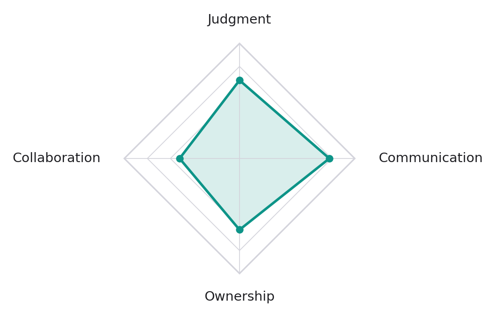

# Engagement Success Guide

Clients hire the Foundry with high expectations. This guide exists to help teams meet and exceed
those expectations, from the first week to roll-off.

Clients have the same AI tools we do. They are looking for expertise, critical thinking and good
judgment beyond what they get from AI tools and coding agents alone. Read this guide before your first client
call, and refer to the [checklist](#checklist) often.

## Your team {#team}

Each client team has three people: a Faculty Project Advisor (Professor Murff or Professor
Toborg), an MBA Engagement Lead and an undergraduate Associate. Top-tier consulting firms staff
engagements this way because the structure supports coaching, mentorship and growth at every
level. To deliver excellent work consistently, the Foundry operates the same way.

Your Project Advisor works closely with your team: solving problems with you and reviewing
deliverables before they reach the client. They meet with each team for 25 minutes in the
Thursday 9:30 to 10:45 slot, meet at other times as needed, and frequently join client calls.

| Role | Who | What they own |
|---|---|---|
| **Faculty Project Advisor** | Professor Murff or Professor Toborg | The client relationship: finding the client, the scope and the fee. Answers to the client for the result. Works through problems with the team, reviews deliverables, meets with the team every Thursday, and joins client calls |
| **Engagement Lead** | A second-year MBA | Everything an Associate does, plus: the client's main day-to-day contact, the final say on sprint priorities when the two of you disagree, and a review of the team's work before it goes to the Project Advisor and the client. Answers to the Project Advisor for the result |
| **Associate** | An undergraduate junior or senior | Owns workstreams end to end, talks with the client, and presents their own work |

Because AI lets everyone build, both students build and consult. The Engagement Lead's
coordination is added to their build work.

**Both of you:**

- Build and ship your workstreams, from build to demo
- Talk with the client directly, bring a point of view to every meeting, and present your own
  work
- Read the client's code, documents and data before asking about them
- Deliver what was agreed, on the date agreed, and reply to the client the same day
- Plan each sprint together and demo every week
- Raise risks to your Project Advisor the same day
- Give each other feedback every two weeks ([Feedback Guide](14-feedback-guide.qmd))

**Leading client engagements.** In a consulting firm, the engagement lead has typically been an
associate first. Most Engagement Leads in the Foundry have not, so taking the lead may be a gradual transition from the Project Advisor. Early on,
your Project Advisor may lead client meetings with the Engagement Lead alongside. As the
Engagement Lead demonstrates they are ready, they begin to lead meetings, and the Project Advisor continues to
join calls where helpful.

Both the Engagement Lead and the Associate spend **20 hours a week** on the team's work.

### Two projects {#two-projects}

Every team runs two projects at once: an outside client engagement and a Foundry product. Each has
stakeholders who depend on you, and the Foundry products will have customers of their own. Treat
both stakeholders as clients; everything on this page applies to each.

There are three Foundry products, and two teams work on each one. Client work rises and falls
from week to week, so when one team's client needs more of its time, the other team steps up.

## What clients expect {#client-expects}

Clients who hire the AI Foundry expect professional-level work.

| Clients expect | What it looks like |
|---|---|
| **The hours you committed** | 20 hours a week, the commitment for 6.0 credit hours. |
| **Contact between calls** | Reply to client messages the day they arrive, ideally within minutes or hours, even if only to acknowledge them and say when the full answer is coming. If a message comes in after 10 PM, a reply the following day is appropriate. In general, overcommunicate, so the client always knows where things stand and what to expect from you next. |
| **You've done your homework** | Read the code, documents and data the client gave you before asking questions whose answers may be in them. Keep a running log of their answers so each question is asked once. |
| **Your own thinking and a point of view** | Everyone has the same starting point with AI. Your value is the critical thinking and the right questions you bring to it. Always have a point of view on the right answer, update it as new facts emerge, and be ready to share it. |
| **A human touch** | Use AI for the work, then make it yours: read, check and edit everything before it goes out, emails included. Don't send deliverables, emails or other outputs that you cannot stand behind and explain. |

## The first week {#first-week}

The first week sets the pace for the engagement. Access is the most common early delay, so ask
for it on day one.

**Day one: ask for access, in one message.** Send the client a single list of everything you
need, with who on the team needs each item:

- Code repositories, and the hosting and deployment accounts behind them
- Data: exports, databases, or read-only reports, and who owns each
- Documents: process maps, past attempts, and anything the client has already written down
- The tools the team will use with them: Slack or Teams channel, shared drive, project board
- Test accounts for any system you will build against
- Names of the people you should talk to, beyond your main contact

Follow up on anything missing after two business days. If access is still blocked after that,
raise it with your Faculty Project Advisor.

**Before you touch client data,** make sure you understand the client's expectations for AI use
and data security. Work with your Project Advisor to get them clear.

**The kickoff call.** Come with an agenda, and leave with answers to these questions:

- What does success look like at the end of the engagement?
- Who decides, who is your day-to-day contact, and who else needs to be kept informed?
- How will you communicate, and when is the weekly call?
- What is the first deliverable, and when is it due?

Send the summary the same day.

## The Consultant diamond on a client team {#diamond}

Your clients, your teammate and your Project Advisor rate you on the four axes of the Consultant
diamond through a survey in the app, at the midpoint and at the end of each engagement. For each
behavior below, they say how often you do it, from Rarely to Always.

{fig-alt="The Consultant diamond, with Judgment at the top, Communication on the right, Ownership at the bottom and Collaboration on the left" width="55%" fig-align="center"}

| Axis | The goal | The behaviors raters look for |
|---|---|---|
| **Judgment** | Solve the right problem in a logical way | Clarify the goal before you start. Focus on what matters most. When something isn't working, find a better way to do it. |
| **Communication** | Be understood quickly | Put the main point first. Write and speak clearly, and explain technical things in plain language. When you need a decision, state it with a recommendation so it can be settled without a meeting. |
| **Ownership** | Get the work done and keep people informed | Do what you say you will, by the date you say. Be available when you said you would be. Keep working on a problem until it's solved, without waiting to be told. Send updates without being asked, and report problems as soon as you find them. |
| **Collaboration** | Work well with the client and your team | Make changes in response to feedback. Speak up when you disagree, and do it respectfully. Help others get their work done, and share credit. |

## Feedback every two weeks {#feedback}

Every two weeks, the two of you set aside 15 minutes to give each other feedback on both the
Builder and the Consultant axes. The [Feedback Guide](14-feedback-guide.qmd) shows how to run the
session.

## Checklist {#checklist}

**First week**

- [ ] Signed any nondisclosure agreement and read the engagement letter's data terms
- [ ] Sent the client one list of every access you need, on day one
- [ ] Followed up on missing access after two business days
- [ ] Read everything the client has shared before the kickoff call
- [ ] Agreed at kickoff, in writing: what success looks like, who decides, your contact, how and when you communicate, and the first deliverable with its date
- [ ] Started a shared log of questions, answers, and decisions

**Every week**

- [ ] Worked the hours you committed, or told the client and faculty in advance
- [ ] Replied to client messages the day they arrived (next day if after 10 PM), at least to acknowledge them
- [ ] Sent at least one written update between calls
- [ ] Raised every blocker within 48 hours
- [ ] Brought the actual work to the faculty deep dive

**Every two weeks**

- [ ] Held the 15-minute feedback session, and reported back on the change you agreed to last time

**Before each client call**

- [ ] Sent the agenda at least one business day ahead
- [ ] Finished every requested deliverable, or told the client about the slip before the call
- [ ] Updated your point of view with what you learned, and can explain your reasoning
- [ ] Checked that every question is one the materials cannot answer, and none is a repeat
- [ ] Verified every piece of AI output you will show, and can explain all of it

**After each client call**

- [ ] Sent a summary the same day: decisions, actions, owners, and dates

**At roll-off**

- [ ] Delivered a written handoff of everything you built, where it lives, and how to run it
- [ ] Moved every repository and account the client will keep into the client's ownership
- [ ] Returned or deleted client data as the engagement letter says, and gave up your access
- [ ] Updated your exposure list with every client contact you worked with
- [ ] Completed your peer evaluations
