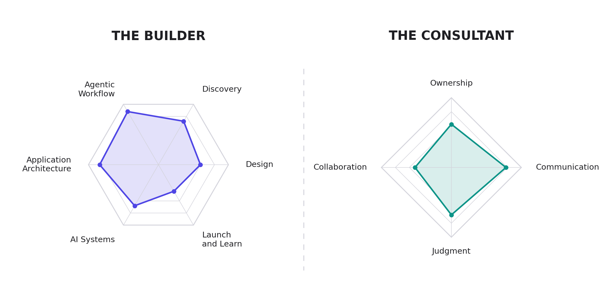

# Feedback Guide

Every two weeks, teammates set aside 15 minutes to give each other feedback, in both directions.
This follows the Foundry's [Ask First](00-constitution.qmd#the-ask-first-feedback-culture) norm:
ask for feedback rather than waiting for it.

Cover both halves of the [Developmentship Model](06-builder-and-consultant.qmd): the six Builder
axes (what you build) and the four Consultant axes (how you work with the client and each other).

{fig-alt="The Builder hexagon (Agentic Workflow, Discovery, Design, Launch and Learn, AI Systems, Application Architecture) beside the Consultant diamond (Judgment, Communication, Ownership, Collaboration)"}

## The session

One person at a time:

1. **Ask.** "Which axis should I work on most, and what is one thing I could have done better?"
2. **Give one instance** from the last two weeks: what happened, and what it affected.
3. **Say which way it missed:** too little or too much.
4. **Agree on one change** to try next sprint. The person receiving it writes it down and reports
   back at the next session.
5. **Name one thing that worked,** with its instance.

## Make it specific

Point to the artifact (commit, pull request, screen, update) or the moment (a client call, a
message). On a Consultant axis, name the behavior, using the list in the
[Engagement Success Guide](13-engagement-success-guide.qmd#diamond).

| Axis | Too general | Specific |
|---|---|---|
| **Application Architecture** (Builder) | "Your code is messy." | "The intake form went straight to main with no tests and broke login on staging. Open a pull request and run the tests before you merge." |
| **Communication** (Consultant) | "Your updates are unclear." | "Friday's update listed tasks in the order you did them, and the request for a test account was in the last paragraph. Lead with the state of the work and what you need from the client." |

## Receiving it

Ask questions until you understand the instance, then decide what you will change. Thank the
person. If an issue does not resolve between the two of you, bring it to your Project Advisor.
